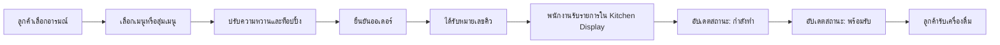

# Mood Drink — ระบบสั่งเครื่องดื่มและจัดการคิว

> โปรเจกต์รายวิชา GEN351 สำหรับช่วยลูกค้าเลือกเครื่องดื่มตามอารมณ์ สั่งล่วงหน้า ติดตามคิว และช่วยพนักงานจัดลำดับการผลิตเครื่องดื่มแบบเรียลไทม์

## แนวคิดของโครงการ

ลูกค้ามักใช้เวลาตัดสินใจเลือกเครื่องดื่มและรอคิวหน้าร้าน ระบบ **Mood Drink** จึงออกแบบประสบการณ์ให้เริ่มจากความรู้สึกของลูกค้า แล้วพาไปสู่เมนูที่เลือกได้ง่ายขึ้น ลูกค้าปรับความหวานและท็อปปิ้ง ยืนยันออเดอร์ และติดตามสถานะคิวบนโทรศัพท์ได้ทันที

ในฝั่งร้าน พนักงานเห็นออเดอร์เรียงตามหมายเลขคิว เปลี่ยนสถานะการทำเครื่องดื่ม และแจ้งลูกค้าเมื่อแก้วพร้อมรับได้จากหน้าจอเดียว

## จุดเด่นสำหรับการนำเสนอ

- **Mood-based ordering** — ลูกค้าเริ่มเลือกจากอารมณ์และมีปุ่มสุ่มเมนูเมื่อตัดสินใจไม่ถูก
- **ปรับเครื่องดื่มได้รายแก้ว** — เลือกความหวาน `ปกติ` หรือ `หวานมากพิเศษ` และเพิ่มท็อปปิ้งได้
- **โปรโมชั่นอัตโนมัติ** — เมื่อเลือกครบ 3 แก้ว ระบบคิดราคา 100 บาท โดยบวกค่าท็อปปิ้งเพิ่ม
- **คิวแบบเรียลไทม์** — ลูกค้าติดตามสถานะ `รอจัดเตรียม → กำลังทำ → พร้อมรับ` ได้ทันที
- **Staff Portal แยกจากลูกค้า** — หน้า `/admin` ใช้ Firebase Authentication และตรวจ role `staff` หรือ `admin`
- **หน้าจอพนักงานใช้งานง่าย** — มี Kitchen Display และ Queue Management สำหรับดูรายละเอียดออเดอร์ ค้นหาคิว และเปลี่ยนสถานะ
- **Responsive Claymorphism UI** — ใช้ได้บนมือถือ แท็บเล็ต และเดสก์ท็อป พร้อม Framer Motion สำหรับการเคลื่อนไหวของหน้าเว็บ

## เส้นทางการใช้งาน



## กลุ่มผู้ใช้

| ผู้ใช้ | สิ่งที่ทำได้ |
| --- | --- |
| ลูกค้า | เลือกเมนู ปรับเครื่องดื่ม สั่งล่วงหน้า ดูคิว และส่ง Feedback |
| พนักงาน (`staff`) | ดูรายการคิว เปลี่ยนสถานะคิว และจัดการคิวประจำวัน |
| ผู้ดูแล (`admin`) | สิทธิ์เช่นเดียวกับพนักงาน และแก้ไขข้อมูลเมนูหรือท็อปปิ้งผ่าน Firebase ได้ |

## ฟีเจอร์หลัก

### ฝั่งลูกค้า

1. หน้าแรกแนะนำคอนเซปต์ Mood Drink และลิงก์ Instagram
2. หน้าเลือกอารมณ์/เมนู พร้อมรูปเครื่องดื่มจริงและปุ่มสุ่มเมนู
3. หน้าปรับแต่งแต่ละแก้ว เลือกความหวานและท็อปปิ้ง
4. หน้าสรุปออเดอร์ คำนวณราคาและส่วนลดโปรโมชั่น 3 แก้ว 100 บาท
5. สร้างหมายเลขคิวแบบต่อเนื่องด้วย Firestore transaction
6. หน้าติดตามคิวแบบเรียลไทม์ พร้อมรายละเอียดรายการและสถานะ
7. แบบฟอร์ม Feedback แยกเป็นหน้าเฉพาะ

### ฝั่งพนักงาน

1. เข้าสู่ระบบที่ `/admin` ด้วยบัญชี Firebase Authentication
2. Kitchen Display แสดงออเดอร์ที่รอทำ กำลังทำ และพร้อมรับ
3. Queue Management แสดงคิวปัจจุบัน ค้นหาจากชื่อหรือหมายเลขคิว และเปลี่ยนสถานะ
4. ย้ายรายการที่รับแล้วไปยังประวัติ หรือปิดรอบคิวประจำวัน
5. Loading state และสีแยกสถานะเพื่อช่วยให้เห็นลำดับงานชัดเจน

## เทคโนโลยีที่ใช้

| เทคโนโลยี | หน้าที่ |
| --- | --- |
| React 19 + TypeScript | สร้างส่วนติดต่อผู้ใช้และกำหนดชนิดข้อมูล |
| Vite | เครื่องมือสำหรับพัฒนาและ build เว็บไซต์ |
| React Router | แยกเส้นทางลูกค้าและ Staff Portal |
| Firebase Firestore | เก็บเมนู ท็อปปิ้ง ออเดอร์ คิว Feedback และประวัติ |
| Firebase Authentication | ยืนยันตัวตนของพนักงานด้วยอีเมลและรหัสผ่าน |
| Firestore Security Rules | จำกัดสิทธิ์เข้าถึงข้อมูลตาม role |
| Framer Motion | แอนิเมชันระหว่างหน้าและองค์ประกอบหน้าแรก |
| Lucide React | ไอคอนในส่วนติดต่อผู้ใช้ |
| CSS + Tailwind CSS | สร้างธีม Claymorphism และ Responsive layout |

## โครงสร้างโปรเจกต์

```text
WebBooking-MoodDrink/
├── README.md                       # เอกสารโครงการฉบับนี้
└── my-mood-drink/                  # แอปพลิเคชันหลัก
    ├── public/
    │   ├── images/                 # รูปเมนูเครื่องดื่ม
    │   └── mood-drink-icon.svg     # Favicon ของเว็บไซต์
    ├── src/
    │   ├── App.tsx                 # Flow ของลูกค้า
    │   ├── main.tsx                # จุดเริ่มต้นและเส้นทาง URL
    │   ├── index.css               # ธีมและ Responsive styles
    │   ├── services/
    │   │   └── firebase.ts         # การเชื่อมต่อ Firebase
    │   └── order/
    │       ├── components/
    │       │   ├── customer/       # หน้าจอลูกค้า
    │       │   ├── admin/          # หน้าจอพนักงานและการยืนยันสิทธิ์
    │       │   └── shared/         # UI ที่ใช้ร่วมกัน
    │       ├── hooks/              # Firestore subscriptions และ business logic
    │       ├── types/              # TypeScript interfaces
    │       ├── utils/              # การคิดราคาและจับคู่รูปเมนู
    │       └── data/               # ข้อมูลคำถามชวนคุย
    ├── firestore.rules             # กฎสิทธิ์ Firestore
    ├── firebase.json               # การตั้งค่า deploy Firebase
    └── FIREBASE_STAFF_SETUP.md     # วิธีตั้งค่าบัญชีพนักงาน
```

## โครงสร้างข้อมูลใน Firestore

| Collection | หน้าที่ |
| --- | --- |
| `moods` | รายการเมนู/อารมณ์ ราคา รูป และสถานะการขาย |
| `addons` | รายการท็อปปิ้ง ราคา รูป และสถานะการขาย |
| `orders` | ออเดอร์ที่กำลังอยู่ในคิว |
| `dailyCounters` | เก็บเลขคิวล่าสุดของแต่ละวัน |
| `orderHistory` | ออเดอร์ที่เก็บหลังปิดวันหรือเคลียร์รายการสำเร็จ |
| `feedback` | ความคิดเห็นที่ลูกค้าส่ง |
| `users` | role ของผู้ใช้พนักงาน เช่น `staff` และ `admin` |

ตัวอย่างข้อมูลออเดอร์:

```json
{
  "queueNumber": 4,
  "customerName": "สมชาย",
  "items": [
    {
      "drinkname": "แดงมะนาวโซดา",
      "sweetnessLevel": "ปกติ",
      "addons": [{ "name": "วุ้นเฉาก๊วย", "price": 5 }],
      "price": 40
    }
  ],
  "totalPrice": 40,
  "status": "pending"
}
```

## วิธีเปิดใช้งานในเครื่อง

```bash
cd my-mood-drink
npm install
npm run dev
```

เปิดเว็บไซต์ตาม URL ที่ Vite แสดงใน Terminal โดยทั่วไปคือ `http://localhost:5173`

คำสั่งที่ใช้บ่อย:

```bash
npm run dev      # เปิดโหมดพัฒนา
npm run build    # ตรวจ TypeScript และสร้างไฟล์สำหรับ deploy
npm run lint     # ตรวจรูปแบบและข้อผิดพลาดของโค้ด
npm run preview  # ดูเว็บไซต์หลัง build
```

## การตั้งค่า Firebase สำหรับพนักงาน

1. เปิด **Firebase Authentication** และเปิดวิธีเข้าสู่ระบบแบบ **Email/Password**
2. สร้างบัญชีพนักงานในเมนู **Users**
3. นำ UID ของบัญชีไปสร้างเอกสารที่ `users/{uid}` ใน Firestore
4. ใส่ field `role` เป็น `staff` หรือ `admin`
5. Deploy Firestore Rules ก่อนใช้งานจริง

```bash
firebase deploy --only firestore:rules
```

รายละเอียดเพิ่มอยู่ใน [my-mood-drink/FIREBASE_STAFF_SETUP.md](my-mood-drink/FIREBASE_STAFF_SETUP.md)

## ลำดับเดโมสำหรับการพรีเซนต์

1. เปิดหน้าแรก อธิบายแนวคิด “Drink Your Mood” และ UI ที่ตอบสนองทุกหน้าจอ
2. เลือกเมนูหรือกดสุ่มเมนู แสดงการเลือกได้สูงสุด 3 แก้ว
3. เลือกความหวานและเพิ่มวุ้นเฉาก๊วย เพื่อแสดงการปรับแต่งรายแก้ว
4. เลือกครบ 3 แก้วเพื่อสาธิตโปรโมชัน 100 บาทและค่าท็อปปิ้ง
5. ยืนยันออเดอร์เพื่อแสดงหมายเลขคิวและหน้าติดตามสถานะ
6. เปิด `/admin` ด้วยบัญชีพนักงาน และอธิบายการตรวจ role
7. เปลี่ยนสถานะเป็น “กำลังทำ” และ “พร้อมรับ” เพื่อแสดงการอัปเดตคิวที่ลูกค้าเห็นทันที
8. แสดงหน้า Queue Management และการค้นหาหมายเลขคิวหรือชื่อลูกค้า

## สถานะของโครงการ

โปรเจกต์มี flow การสั่งเครื่องดื่ม การคำนวณโปรโมชั่น การจัดคิว และ Staff Portal พร้อมใช้งาน โดยต้องตั้งค่า Firebase Authentication, ข้อมูลเมนู และ Firestore Rules ให้ครบก่อนนำไปใช้งานจริง
